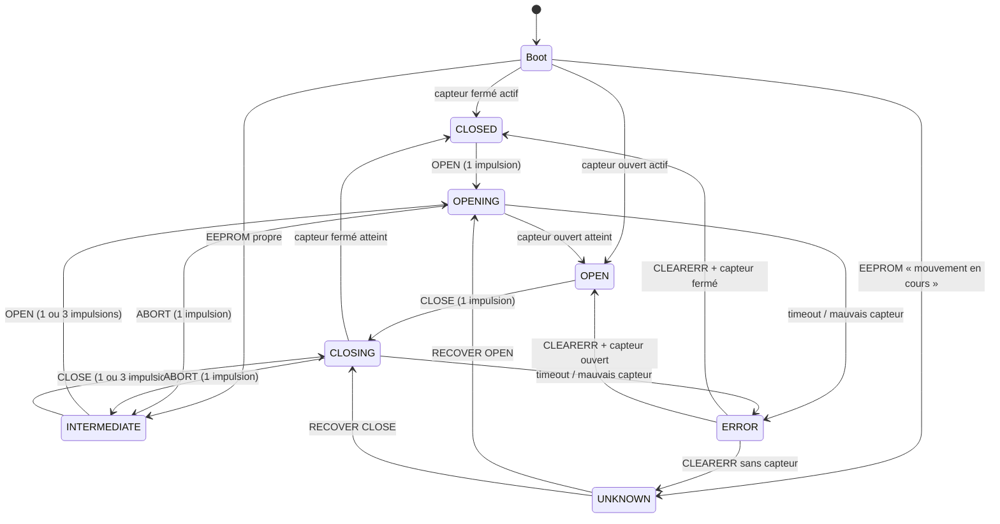

# Protocole série — Contrôleur de toit coulissant

> **Ce document est le contrat entre le firmware Arduino et le driver ASCOM.**
> Les deux implémentations doivent s'y conformer *à la lettre*. Toute évolution du protocole doit
> être décidée conjointement et reportée ici **avant** d'être codée d'un côté ou de l'autre.

**Version du protocole : `1.0`**

---

## 1. Couche physique

| Paramètre | Valeur |
|---|---|
| Liaison | USB série (CH340 / FT232 sur Arduino Nano) |
| Débit | **115200** bauds |
| Format | 8 bits, pas de parité, 1 stop (8N1) |
| Contrôle de flux | aucun |
| Jeu de caractères | ASCII imprimable uniquement |
| Fin de ligne (PC → Arduino) | `\n` (le firmware doit tolérer `\r\n` et ignorer les `\r`) |
| Fin de ligne (Arduino → PC) | `\r\n` (lisible tel quel dans le moniteur série de l'IDE Arduino) |
| Longueur max d'une ligne | 80 caractères |

Les commandes sont en **MAJUSCULES**. Le firmware doit néanmoins accepter les minuscules
(normalisation en majuscules à la réception). Les champs sont séparés par **un seul espace**.

### Reset au DTR — comportement imposé

L'ouverture du port série par le PC provoque un **reset matériel du Nano** (signal DTR). En
conséquence :

* le driver **doit** attendre **2500 ms** après l'ouverture du port avant d'émettre sa première
  commande, puis vider le tampon de réception ;
* le firmware **doit** restaurer son état depuis l'EEPROM au démarrage (voir §5) — sans quoi chaque
  connexion de NINA perdrait la position du toit ;
* le driver **doit** tenter le handshake `PING` **3 fois** (1 s entre chaque) avant de déclarer
  l'échec.

---

## 2. Modèle d'échange

**Strictement requête / réponse.** Le PC envoie une ligne, le firmware répond par **exactement une
ligne de réponse**. Le firmware n'émet jamais de message spontané, à deux exceptions près décrites
ci-dessous.

### Lignes de commentaire

Toute ligne commençant par `#` est **informative** et **doit être ignorée par le driver**. Elle peut
apparaître à tout moment, y compris avant une ligne de réponse. C'est le canal de trace du firmware.

Au démarrage, le firmware émet obligatoirement :

```
# ROOF CONTROLLER <version> BOOT
```

### Contrainte de temps

Le firmware **doit** répondre dans les **100 ms** suivant la réception d'une ligne complète.
Le driver utilise un timeout de lecture de **1000 ms**.

Aucune commande n'est bloquante : `OPEN`, `CLOSE`, `ABORT` et `RECOVER` rendent la main
immédiatement, le mouvement se poursuit en tâche de fond et se suit par `STATE`.

---

## 3. Vocabulaire d'état

### `<pos>` — position du toit

| Valeur | Signification |
|---|---|
| `CLOSED` | capteur « fermé » actif |
| `OPEN` | capteur « ouvert » actif |
| `INTERMEDIATE` | aucun capteur actif, **position connue par l'automate** (arrêt à mi-course volontaire) |
| `UNKNOWN` | aucun capteur actif et **automate désynchronisé** (coupure secteur en pleine course, impulsion brute) |

### `<motion>` — mouvement en cours

| Valeur | Signification |
|---|---|
| `IDLE` | à l'arrêt |
| `OPENING` | ouverture en cours (surveillée) |
| `CLOSING` | fermeture en cours (surveillée) |
| `ERROR` | erreur active, tout mouvement refusé jusqu'à `CLEARERR` |

### `<next>` — modèle de l'automate du moteur

Ce que produira la **prochaine impulsion** : `OPEN` ou `CLOSE`. C'est la modélisation de l'état
interne du moteur de portail séquentiel (voir §4).

### `<err>` — code d'erreur

| Code | Cause |
|---|---|
| `NONE` | aucune erreur |
| `TIMEOUT_START` | le capteur de départ ne s'est pas relâché dans `START` ms → l'impulsion n'a rien produit (moteur hors tension, contact HS, relais défaillant) |
| `TIMEOUT_TRAVEL` | le capteur cible ne s'est pas activé dans `TRAVEL` ms → obstacle, moteur bloqué, capteur HS |
| `BOTH_SENSORS` | les deux capteurs actifs simultanément → câblage ou capteur défaillant |
| `WRONG_DIRECTION` | le toit est arrivé sur le capteur **opposé** à la cible → le modèle `next` était faux, il a été corrigé automatiquement |
| `INTERRUPTED` | au démarrage : l'EEPROM indiquait un mouvement en cours → position perdue |
| `SENSOR_LOST` | à l'arrêt, une fin de course s'est désactivée **sans qu'aucun mouvement ait été commandé** → toit déplacé manuellement, capteur déréglé, ou câble coupé |

---

## 4. Automate du moteur séquentiel

Le moteur de portail n'a **qu'une entrée impulsionnelle** et avance d'un cran à chaque impulsion :

```
OUVRE → STOP → FERME → STOP → OUVRE → …
```

Le firmware maintient donc `next ∈ {OPEN, CLOSE}` = effet de la prochaine impulsion.

### Invariant capteurs (règle prioritaire, évaluée en permanence)

```
swClose=1, swOpen=0  →  pos=CLOSED, next=OPEN,  motorAssumedRunning=false
swOpen=1,  swClose=0 →  pos=OPEN,   next=CLOSE, motorAssumedRunning=false
swClose=1, swOpen=1  →  motion=ERROR, err=BOTH_SENSORS
swClose=0, swOpen=0  →  pos inchangée (INTERMEDIATE ou UNKNOWN)
                        SAUF si pos vaut CLOSED ou OPEN a l'arret : voir ci-dessous
```

### Détection de perte de capteur

Si, **à l'arrêt** (`motion = IDLE`, aucune impulsion en vol), `pos` vaut `CLOSED` ou `OPEN` alors
qu'**aucune fin de course n'est active**, il y a contradiction : la position affirme être sur une
butée que le capteur ne confirme pas, et rien n'a été commandé. Si cette contradiction dure
**3000 ms sans interruption** (`SENSOR_LOST_CONFIRM_MS`, firmware ≥ 1.1.0), le firmware passe
`pos = UNKNOWN` et lève `SENSOR_LOST`.

> **Pourquoi 3 s.** Avec le seul `DEBOUNCE` (50 ms), un toit qui vibre sur sa butée (vent,
> dilatation nocturne) suffisait à lever l'erreur, laquelle bloquait ensuite la fermeture du matin.
> Un fil coupé ou un toit déplacé à la main produit un relâchement **permanent** : il reste détecté,
> 3 s plus tard. Pendant ces 3 s, `pos` garde sa valeur précédente.

> ⚠ **Pourquoi c'est indispensable.** Sans cette détection, un simple fil de capteur coupé ferait
> annoncer `shutterClosed` **indéfiniment** — toit grand ouvert compris. Le client (NINA) croirait
> l'observatoire en sécurité alors qu'il ne l'est pas. C'est le pire mode de défaillance possible
> pour ce type d'équipement : une panne silencieuse qui se présente comme un état sûr.

Le modèle `next` est lui aussi considéré comme non fiable dans ce cas : si le toit a bougé sans
commande, le portail a pu consommer une étape de son cycle. D'où le passage par `UNKNOWN`, qui impose
un `RECOVER` explicite sous surveillance visuelle.

Cette règle ne se déclenche jamais pendant une course : durant un mouvement `motion` vaut `OPENING`
ou `CLOSING`, et le relâchement du capteur de départ est précisément ce que la supervision attend.
Elle ne s'empile pas non plus : si `motion` vaut déjà `ERROR`, aucune nouvelle erreur n'est levée.

**Persistance.** Comme toute erreur (§3), `SENSOR_LOST` reste active jusqu'à `CLEARERR`, **y compris
si une fin de course vient ensuite reconfirmer une position**. L'invariant met bien `pos` à jour pour
le diagnostic, mais `motion` reste `ERROR` et le client continue de voir `shutterError`. C'est
délibéré : un toit qui bouge sans commande est un événement anormal, il doit interrompre
l'automatisation et non se résorber silencieusement.

Chemin de reprise nominal :

| Étape | Résultat |
|---|---|
| `CLEARERR` sans fin de course active | `pos = UNKNOWN`, `err = NONE` — client toujours en `shutterError` |
| Une fin de course devient active | `pos` déduite du capteur, `next` forcé, `motion = IDLE` — client en `shutterOpen` / `shutterClosed` |

> Un capteur de fin de course mal réglé qui vibre au-delà de `DEBOUNCE` déclenchera cette erreur.
> C'est le comportement voulu : le défaut mécanique doit remonter, pas être masqué. Corriger le
> réglage du capteur, ou augmenter `DEBOUNCE`.

Cet invariant recale la position et le modèle `next` sur la réalité physique dès qu'un capteur est
actif. C'est ce qui rend l'automate auto-correcteur.

> **Rebond du capteur de départ** (firmware ≥ 1.1.0). Une fois le capteur de départ relâché, sa
> réactivation dans les **2000 ms** qui suivent (`DEPART_REARM_MS`) est un rebond mécanique, pas une
> arrivée. Sans cette garde, un capteur qui rebondit au démarrage était pris pour une arrivée sur la
> butée opposée (`WRONG_DIRECTION`) alors que le toit roulait normalement vers sa cible.

> **Exception — phase de démarrage.** L'invariant n'est **pas** appliqué entre l'émission de
> l'impulsion de démarrage et le relâchement du capteur de départ. Pendant cette fenêtre le toit est
> encore sur sa butée : appliquer l'invariant y remettrait `next` et `motorAssumedRunning` à leur
> valeur de repos et tuerait le mouvement qui vient de démarrer. C'est la supervision de course
> (§4, timeout `START`) qui fait autorité durant cette phase, elle seule sachant distinguer le
> capteur de départ du capteur cible.

### Transitions de `next`

`next` décrit l'effet d'une impulsion **lorsque le moteur est à l'arrêt**. Pendant un mouvement, une
impulsion vaut toujours **arrêt** — c'est la nature même du cycle séquentiel.

| Événement | Nouveau `next` |
|---|---|
| Capteur `CLOSED` atteint | `OPEN` (forcé) |
| Capteur `OPEN` atteint | `CLOSE` (forcé) |
| Impulsion de **démarrage** émise | bascule (`OPEN` ⇄ `CLOSE`) |
| Impulsion d'**arrêt** pendant `OPENING` | `CLOSE` |
| Impulsion d'**arrêt** pendant `CLOSING` | `OPEN` |

⚠ La bascule s'applique aux seules impulsions de **démarrage**. L'appliquer aussi aux impulsions
d'arrêt contredirait les deux dernières lignes du tableau et casserait la séquence à 3 impulsions —
le toit repartirait dans le mauvais sens.

### Nombre d'impulsions par commande

| Situation de départ | Commande | Impulsions |
|---|---|---|
| Sur une fin de course | sens opposé | **1** |
| `INTERMEDIATE`, `next` == sens demandé | — | **1** |
| `INTERMEDIATE`, `next` == sens opposé | — | **3** (démarre à l'envers → arrête → repart) |

⚠ La séquence à 3 impulsions déplace le toit dans le **mauvais sens** pendant environ
`PULSE + INTER` ms. C'est inévitable avec une commande unique. Le paramètre `INTER` doit être réglé
au plus court **tout en restant supérieur au temps de prise en compte du portail**, sinon
l'impulsion d'arrêt est ignorée et le toit part en butée dans le mauvais sens.

### `motorAssumedRunning`

Booléen interne : `true` dès qu'une impulsion de démarrage est émise, `false` après une impulsion
d'arrêt ou dès qu'une fin de course est atteinte. Il conditionne le comportement d'`ABORT`.

### Diagramme



---

## 5. Persistance EEPROM

Le firmware persiste `pos`, `next` et un drapeau `moving` **à chaque transition d'état** (donc
rarement : pas de risque d'usure). Un octet magique + une somme de contrôle valident le bloc.

Au démarrage :

| Condition | Résultat |
|---|---|
| Un capteur actif | position déduite du capteur, `next` forcé, EEPROM ignorée |
| Aucun capteur + EEPROM valide + `moving=0` + `pos` persistée `INTERMEDIATE` | `pos=INTERMEDIATE`, `next` restauré depuis l'EEPROM |
| Aucun capteur + EEPROM valide + `moving=0` + `pos` persistée `UNKNOWN` | `pos=UNKNOWN` — une position perdue le reste. Annoncer `INTERMEDIATE` ferait croire au driver que la position est connue |
| Aucun capteur + EEPROM valide + `moving=1` | `pos=UNKNOWN`, `motion=ERROR`, `err=INTERRUPTED` |
| Aucun capteur + EEPROM invalide / vierge | `pos=UNKNOWN`, `motion=ERROR`, `err=INTERRUPTED` |

---

## 6. Jeu de commandes

### `PING` — handshake

```
→ PING
← PONG ROOF 1.0 1.0.0
```

Format : `PONG ROOF <versionProtocole> <versionFirmware>`.
Le driver **doit** vérifier que `<versionProtocole>` commence par `1.` et refuser la connexion sinon.

---

### `STATE` — état complet (commande de polling)

```
→ STATE
← STATE <pos> <motion> <swClose> <swOpen> <relay> <next> <elapsed> <err>
```

| Champ | Type | Description |
|---|---|---|
| `<pos>` | énum | `CLOSED` \| `OPEN` \| `INTERMEDIATE` \| `UNKNOWN` |
| `<motion>` | énum | `IDLE` \| `OPENING` \| `CLOSING` \| `ERROR` |
| `<swClose>` | `0`\|`1` | capteur « fermé », **1 = contact fermé** (déjà normalisé, polarité gérée par le firmware) |
| `<swOpen>` | `0`\|`1` | capteur « ouvert », idem |
| `<relay>` | `0`\|`1` | `1` = relais actif à cet instant précis |
| `<next>` | énum | `OPEN` \| `CLOSE` — effet de la prochaine impulsion |
| `<elapsed>` | entier | ms écoulées depuis le début du mouvement en cours (`0` si `IDLE`) |
| `<err>` | énum | voir §3 |

Exemples :

```
STATE CLOSED IDLE 1 0 0 OPEN 0 NONE
STATE INTERMEDIATE OPENING 0 0 0 CLOSE 12480 NONE
STATE UNKNOWN ERROR 0 0 0 OPEN 0 INTERRUPTED
```

Le driver interroge `STATE` **toutes les 1000 ms** par défaut (configurable). C'est sa **seule**
source de vérité : il ne doit jamais déduire l'état d'un `ACK`.

---

### `OPEN` / `CLOSE` — démarrer une course

```
→ OPEN
← ACK OPEN MOVING            mouvement démarré (1 impulsion)
← ACK OPEN MOVING_REVERSE    mouvement démarré via la séquence à 3 impulsions
← ACK OPEN ALREADY           déjà en position, aucune impulsion émise
← NAK OPEN BUSY              un mouvement est déjà en cours
← NAK OPEN ERROR             erreur active → CLEARERR requis
← NAK OPEN UNKNOWN_POSITION  position inconnue → RECOVER requis
```

---

### `ABORT` — arrêt d'urgence

```
→ ABORT
← ACK ABORT STOPPING   impulsion d'arrêt émise
← ACK ABORT IDLE       le moteur était déjà supposé à l'arrêt, aucune impulsion
```

`ABORT` émet une impulsion **si et seulement si** `motorAssumedRunning == true`. Elle est acceptée
**même en état `ERROR`** : c'est une commande de sécurité, elle ne doit jamais être refusée.

Après un `ABORT` réussi : `motion = IDLE`, `pos = INTERMEDIATE`, `next` basculé.

Trois précisions qui priment sur la phrase ci-dessus :

* **`ABORT` n'efface jamais une erreur.** En état `ERROR`, le moteur est bien arrêté mais `motion`
  reste `ERROR` jusqu'à un `CLEARERR` explicite. Effacer l'erreur ici permettrait de relancer
  immédiatement une course sur un défaut non diagnostiqué.
* **`ABORT` ne fait pas réapparaître une position perdue.** Si `pos` valait `UNKNOWN`, elle le reste.
* Si une fin de course est active, l'invariant capteurs (§4) prime : `pos` n'est pas forcée à
  `INTERMEDIATE`.

---

### `CLEARERR` — acquitter une erreur

```
→ CLEARERR
← ACK CLEARERR <pos>
```

Efface `err`, repasse `motion` à `IDLE` et recalcule `pos` selon les règles suivantes, **dans cet
ordre** :

| Condition | `pos` résultante |
|---|---|
| Une fin de course active | déduite du capteur (l'invariant du §4 fait foi) |
| Aucune fin de course **et** une erreur réelle vient d'être acquittée | `UNKNOWN` — après une erreur, la position n'est plus fiable ; un `RECOVER` sera nécessaire |
| Aucune fin de course **et** `err` valait déjà `NONE` | **inchangée** — typiquement `INTERMEDIATE` après un `ABORT` |

> ⚠ La troisième ligne est essentielle. **Effacer une erreur inexistante ne doit jamais détruire une
> position connue.** Sans cette règle, un `CLEARERR` de précaution après un simple `ABORT` à
> mi-course ferait passer le toit en `UNKNOWN` et imposerait un `RECOVER` — lequel peut lancer une
> course complète à contresens. Le remède serait alors bien pire que le mal.

---

### `RECOVER <OPEN|CLOSE>` — reprise depuis une position inconnue

```
→ RECOVER CLOSE
← ACK RECOVER CLOSE
← NAK RECOVER NOT_NEEDED     la position n'est pas UNKNOWN
← NAK RECOVER BAD_ARGS       argument absent ou invalide
← NAK RECOVER ERROR          erreur active → CLEARERR requis d'abord
← NAK RECOVER BUSY           un mouvement est déjà en cours
```

Le chemin imposé par le diagramme du §4 est donc bien `ERROR → CLEARERR → UNKNOWN → RECOVER` :
aucun mouvement n'est possible tant qu'une erreur n'est pas acquittée.

À n'utiliser que depuis `pos = UNKNOWN`. Le modèle `next` n'étant pas fiable, le firmware émet
**une seule impulsion** et surveille **les deux** capteurs :

| Issue | Résultat |
|---|---|
| Capteur cible atteint | `pos = cible`, `motion = IDLE`, `err = NONE` — reprise réussie |
| Capteur **opposé** atteint | `pos = opposé`, `motion = ERROR`, `err = WRONG_DIRECTION`, modèle `next` corrigé. **Le firmware s'arrête là**, il n'enchaîne pas |
| Aucun capteur dans `TRAVEL` ms | `motion = ERROR`, `err = TIMEOUT_TRAVEL` |

> ⚠ Une reprise peut donc faire parcourir au toit une course complète **dans le sens non désiré**.
> C'est assumé : c'est une action opérateur explicite, à faire sous surveillance visuelle. Après
> quoi le toit est sur une fin de course et tout redevient déterministe.

---

### `PULSE` — impulsion brute (diagnostic)

```
→ PULSE
← ACK PULSE
← NAK PULSE BUSY   refusée pendant un mouvement surveillé
```

Émet une impulsion, bascule `next`, et force `pos = UNKNOWN` si aucun capteur n'est actif — le
mouvement résultant n'étant pas surveillé. Réservé à la mise au point.

---

### `DIAG` — diagnostic de câblage

```
→ DIAG
← DIAG SWC=<raw>/<deb> SWO=<raw>/<deb> RELAY=<0|1> NEXT=<OPEN|CLOSE> POS=<pos> MOTION=<motion> ERR=<err> RUN=<0|1> UP=<ms> EE=<OK|INIT|BAD>
```

`raw` = lecture instantanée de la broche (déjà normalisée : `1` = contact fermé),
`deb` = valeur après anti-rebond. Un écart persistant entre les deux signale un capteur qui vibre ou
un câble parasité. `RUN` = `motorAssumedRunning`.

---

### `CFG?` / `CFG <clé> <valeur>` / `CFGRESET` — temporisations

```
→ CFG?
← CFG PULSE=600 INTER=600 START=5000 TRAVEL=60000 DEBOUNCE=50

→ CFG TRAVEL 45000
← ACK CFG TRAVEL=45000
← NAK CFG BAD_KEY         clé inconnue
← NAK CFG BAD_ARGS        argument manquant ou non numérique
← NAK CFG OUT_OF_RANGE    nombre valide mais hors des bornes du tableau ci-dessous

→ CFGRESET
← ACK CFGRESET
```

`OUT_OF_RANGE` est réservé aux **nombres valides hors bornes**. Une valeur non numérique est un
`BAD_ARGS`, ce qui permet au driver de distinguer une erreur de saisie d'un réglage à corriger.

| Clé | Défaut | Plage | Rôle |
|---|---|---|---|
| `PULSE` | `600` | 100 – 2000 | durée de fermeture du contact relais |
| `INTER` | `600` | 200 – 5000 | délai entre la **fin** d'une impulsion et le **début** de la suivante |
| `START` | `5000` | 1000 – 30000 | délai max pour que le capteur de départ se relâche |
| `TRAVEL` | `60000` | 5000 – 300000 | durée max d'une course complète |
| `DEBOUNCE` | `50` | 5 – 200 | anti-rebond des capteurs |

Toute écriture est persistée en EEPROM. `PULSE` est en outre borné en dur à `MAX_PULSE_MS = 2000`
dans le firmware, quelle que soit la valeur configurée.

---

### Commande inconnue

```
→ FOO
← NAK ? UNKNOWN_COMMAND

→ CFG
← NAK CFG BAD_ARGS
```

Une ligne **dépassant 80 caractères** est tronquée, rejetée par `NAK ? UNKNOWN_COMMAND` et le
tampon est purgé jusqu'au prochain `\n`. Le protocole n'introduit volontairement aucun code
supplémentaire : tout ce que le firmware émet doit appartenir au vocabulaire que le driver sait
interpréter.

---

## 7. Règles de sécurité imposées au firmware

1. **Aucun mouvement spontané.** Le firmware ne déclenche jamais d'impulsion de sa propre
   initiative — uniquement en réponse à une commande.
2. `RELAY_PIN` est mis à l'état **inactif** en toute première instruction de `setup()`, avant même
   `Serial.begin()`.
3. Le relâchement du relais est piloté par `millis()`, **jamais** par `delay()` : aucun blocage
   logiciel ne doit pouvoir maintenir le contact fermé.
4. La durée d'impulsion est bornée en dur par `MAX_PULSE_MS`, indépendamment de la configuration.
5. La perte de la liaison série n'a **aucun** effet sur le toit : une course en cours va à son terme
   (le moteur de portail est autonome), et le firmware conserve son état.

## 8. Règles imposées au driver

1. `STATE` est la seule source de vérité. Un `ACK` ne met jamais à jour l'état interne. Après une
   commande de mouvement, le driver relit `STATE` **avant** de rendre la main : ASCOM exige que
   `ShutterStatus` vaille déjà `shutterOpening` / `shutterClosing` au retour d'`OpenShutter` /
   `CloseShutter`.
2. Un seul thread accède au port série (file d'attente + verrou), une requête → une réponse.
3. Les lignes commençant par `#` sont ignorées, y compris avant une réponse attendue.
4. Perte de liaison ⇒ `ShutterStatus = shutterError`. Le driver ne déclenche **jamais** de mouvement
   correctif à la suite d'une perte de liaison, ni après la reconnexion.
5. La déconnexion ASCOM (`Connected = false`) ne ferme **jamais** le toit.
6. **Reprise automatique** (driver ≥ 1.1). Une ouverture ou une fermeture demandée par le client
   ouvre une *mission*. Si le firmware passe en `ERROR` pendant la mission — ou y était déjà —, le
   driver :
   1. attend que le toit soit immobile : fin de course cible active (succès direct), ou une fin de
      course active et stable depuis 2 s, ou aucune fin de course pendant `max(10 s, TRAVEL)` ;
   2. acquitte par `CLEARERR` ;
   3. relance la course : `OPEN` / `CLOSE` si la position est connue, `RECOVER <sens>` si elle est
      `UNKNOWN` (réglage « reprise automatique depuis une position inconnue », actif par défaut).

   Au plus `N` reprises par mission (réglage, défaut 3 ; 0 restaure le comportement d'origine). Tant
   que la mission est active, `ShutterStatus` reste `shutterOpening` / `shutterClosing`, reprises
   comprises, pour que le client continue d'attendre. **Jamais de reprise** sur `BOTH_SENSORS`, sur
   perte de liaison (règle 4), ni après une interruption par une autre commande (`AbortSlew`…).
7. Une demande identique à la mission en cours (`CloseShutter` pendant une fermeture) est acceptée
   sans effet, comme l'exige ASCOM. Une demande opposée arrête d'abord la course (`ABORT`), puis
   repart dans l'autre sens.
